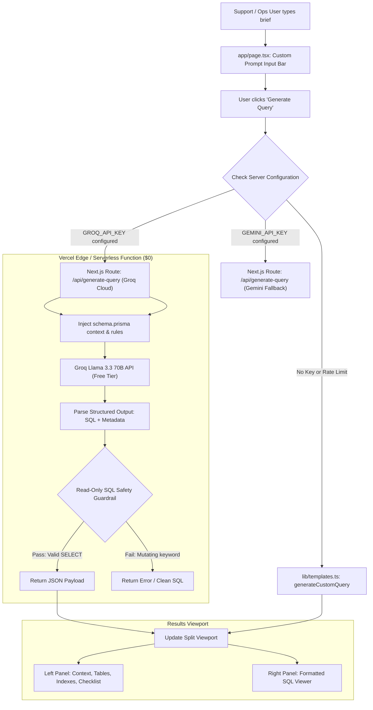

# Revised Custom Prompt AI Architecture & Implementation Plan for Que_Me

This document outlines the architecture, best possible scenarios, trade-offs, and implementation plan for adding **AI-driven SQL query generation** to [`Que_Me`](file:///C:/que_me) while maintaining **$0 hosting and operational cost on Vercel**.

---

## 1. Executive Summary & Objective

When an operator selects **"Custom"** and types an arbitrary freeform investigation brief (e.g., *"Find accounts that suffered stop-out on EURUSD after a sudden spread spike above 10 pips, and check if any support tickets were logged"*), a static heuristic pattern-matcher is insufficient. A real **Large Language Model (LLM)** is required to interpret natural language semantics, resolve relational join paths, and formulate syntactically valid PostgreSQL queries.

The primary constraint is **$0 operational cost** when deployed on Vercel.

---

## 2. Comparison of Best Possible Scenarios

| Criterion | Scenario A: Groq Cloud (Llama 3.3 70B) (Active) | Scenario B: Google Gemini 2.0 Flash (Supported Fallback) | Scenario C: Client-Side "BYOK" (Bring Your Own Key) | Scenario D: Pure Heuristic Fallback Only |
| :--- | :--- | :--- | :--- | :--- |
| **Cost** | **$0 / month** (Free tier via Groq Cloud) | **$0 / month** (Free tier via Google AI Studio) | **$0** to app owner | **$0** (zero dependencies) |
| **Free Tier Quota** | 30 RPM / 14,400 RPD / 6K TPM | 15 RPM / 1,500 RPD / 1M TPM | Depends on user's own key | Unlimited |
| **Inference Latency** | **~300ms - 500ms (Ultra-fast LPU)** | ~600ms - 900ms | ~600ms - 1.2s | Instant (<5ms) |
| **SQL Quality & Reasoning** | Exceptional on complex multi-table queries & reasoning | Exceptional on schema joins & financial edge-cases | Depends on model selected | Fixed to predefined patterns |
| **Vercel Setup Complexity** | **Low**: Set `GROQ_API_KEY` in Vercel project | **Low**: Set `GEMINI_API_KEY` in Vercel project | **Zero**: No env vars needed | **Zero**: Static export ready |
| **Team Usability** | Immediate out-of-the-box for all teammates | Immediate out-of-the-box for all teammates | Requires each user to paste an API key | Immediate |

---

## 3. Recommended Architecture: The Hybrid Zero-Cost Engine

The optimal architecture combines **Groq LPU AI-First Generation** with an **Instant Deterministic Fallback**:



---

## 4. Key Components of the AI Plan

### A. Serverless Endpoint (`app/api/generate-query/route.ts`)
- **Primary Model**: `llama-3.3-70b-versatile` via Groq Cloud (`https://api.groq.com/openai/v1/chat/completions`).
- **Secondary Fallback**: `gemini-2.0-flash` (if `GEMINI_API_KEY` is present).
- **Offline Fallback**: Deterministic heuristic engine (`generateCustomQuery`).
- **Payload Input**:
  ```typescript
  interface GenerateQueryRequest {
    prompt: string;
    loginId?: string;
    dateMode: 'single' | 'range';
    startDate: string;
    endDate?: string;
    parameterized: boolean;
  }
  ```
- **Login ID Target**: Queries target specific accounts using `ta.login = <loginVal>`.
- **Schema Context**: Full relational schema (`TradingAccount`, `Order`, `Deal`, `Position`, `FundTransaction`, `AuditLog`, `UserSession`, `KycDocument`, `SupportTicket`, `Staff`, `Instrument`) injected into the system prompt.
- **Structured JSON Output**:
  ```json
  {
    "sql": "SELECT ... FROM \"TradingAccount\" ta JOIN ...",
    "tables": ["TradingAccount", "Order", "Deal"],
    "indexes": ["TradingAccount_login_key", "Order_accountId_idx"],
    "sensitivity": "Medium",
    "diagnosticNotes": [
      "Interprets order-to-fill latency and checks slippage points.",
      "Check LP gateway logs if latency exceeds 1.5 seconds."
    ]
  }
  ```

### B. Security & Safety Guardrails
1. **Read-Only Enforcement**:
   - The query must begin with `SELECT` or `WITH`.
   - Reject any statement containing destructive DDL/DML tokens: `INSERT`, `UPDATE`, `DELETE`, `DROP`, `ALTER`, `TRUNCATE`, `GRANT`, `REVOKE`, `EXEC`.
2. **Resource Protection**:
   - Automatically append `LIMIT 100` or `200` if the generated query lacks an explicit row limit.
3. **Tenant & Target Isolation**:
   - Target isolation: `ta.login = <loginVal>` must be present in the `WHERE` clause.

### C. Frontend UX Workflow (`app/page.tsx`)
1. **Clean Login ID Input**:
   - Filter directly by account Login ID with an instant clear button (`✕`).
2. **Explicit "Generate Query" Button**:
   - Freeform AI generation is triggered via an explicit button or `Enter` key.
   - Prevents burning through free-tier rate limits while typing.
3. **Interactive Loading State**:
   - Shows a subtle pulsing spinner (`"Synthesizing..."`) while awaiting response (<400ms on Groq).
4. **Graceful Fallback & Status Badge**:
   - Shows badge: `● Groq Llama 3.3 AI Synthesized` or `● AI Engine Ready (Groq Free Tier)` when configured, or `● Heuristic Fallback Active` if no key is set.

---

## 5. Implementation Status & Deployment Guide

### Status: Complete & Verified
- [x] **Account Identification**: All queries target and filter purely via account Login ID across all 10 templates and custom prompt flows.
- [x] **API Route**: Created [`app/api/generate-query/route.ts`](file:///C:/que_me/app/api/generate-query/route.ts) with Groq Cloud (`llama-3.3-70b-versatile`), JSON mode, read-only safety guardrails, and Gemini fallback.
- [x] **Frontend UI**: Integrated Login ID filter, Groq status badges, and interactive synthesis in [`app/page.tsx`](file:///C:/que_me/app/page.tsx).
- [x] **Zero-Cost Free Tier**: Uses Groq Cloud free tier (ultra-fast LPU inference).
- [x] **Zero-Downtime Fallback**: Automatically falls back to [`generateCustomQuery`](file:///C:/que_me/lib/templates.ts#L529) if `GROQ_API_KEY` is not present or if quota is exceeded.

---

## 6. How to Deploy to Vercel with Zero Cost

1. **Get Free Groq API Key** (30 seconds, no credit card):
   - Visit [console.groq.com](https://console.groq.com/).
   - Click **API Keys** -> **Create API Key**.
   - Copy your key (starts with `gsk_...`).

2. **Add Key to Vercel**:
   - Go to your project in [vercel.com](https://vercel.com) -> **Settings** -> **Environment Variables**.
   - Add:
     - Name: `GROQ_API_KEY`
     - Value: `<your-groq-api-key>`
     - Environments: **Production**, **Preview**, **Development**

3. **Deploy**:
   - Push your code to your repository:
     ```bash
     git add .
     git commit -m "feat: use Groq API key and filter exclusively by login id"
     git push origin master
     ```
   - Vercel will automatically build and deploy. All custom prompts will now be dynamically synthesized by Groq Llama 3.3 at ultra-fast speeds and $0 cost!
