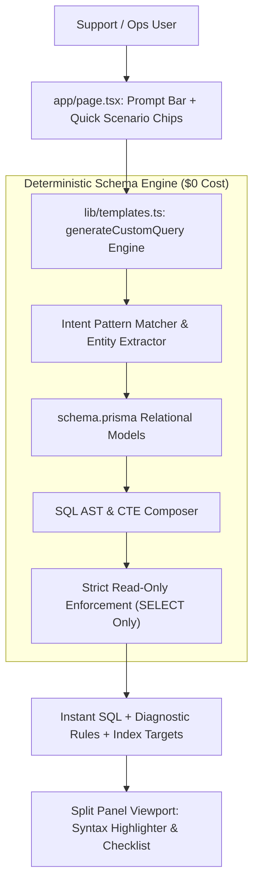

# Custom Prompt Implementation Plan & Zero-Cost Architecture for Que_Me

This document outlines the architecture, deployment specifications, and implemented capabilities of the **Custom Prompt** query generator in [`Que_Me`](file:///C:/Que_Me), designed for **$0 hosting on Vercel**.

---

## 1. Zero-Cost Vercel Architecture

To maintain zero hosting and API billing costs, **Que_Me** uses a deterministic, schema-grounded natural language query engine that runs 100% client-side or on Vercel Serverless / Edge without requiring paid third-party LLM API keys:



---

## 2. Capabilities & Scenarios Covered

The zero-cost engine synthesizes production-grade PostgreSQL 15+ queries with live parameter binding (`:loginId`, `:vendorId`, `:startDate`, `:endDate`) across key operational scenarios:

| Investigation Domain | Trigger Keywords | Target Tables Joined | Indexes Utilized |
| :--- | :--- | :--- | :--- |
| **Leverage & Stop-Out Risk** | `leverage`, `stop-out`, `liquidation`, `margin call`, `closeout` | `TradingAccount`, `AuditLog`, `Deal`, `Staff` | `TradingAccount_vendorId_login_key`, `AuditLog_accountId_idx`, `Deal_accountId_idx` |
| **Cross-Account IP & Device Sharing** | `ip`, `device`, `session`, `collision`, `multi`, `fraud` | `TradingAccount`, `UserSession`, `User` | `TradingAccount_vendorId_login_key`, `UserSession_ipAddress_idx` |
| **Execution Latency & Slippage** | `slippage`, `latency`, `delay`, `spread`, `execution speed` | `TradingAccount`, `Order`, `Deal` | `TradingAccount_vendorId_login_key`, `Order_accountId_idx`, `Deal_orderId_idx` |
| **Deposits, Withdrawals & UTR Tracking** | `deposit`, `withdrawal`, `utr`, `payout`, `wire`, `bank` | `TradingAccount`, `FundTransaction`, `Staff` | `TradingAccount_vendorId_login_key`, `FundTransaction_accountId_idx`, `FundTransaction_utr_idx` |
| **Dealer Manual Overrides** | `dealer`, `manual`, `override`, `staff`, `admin`, `intervention` | `TradingAccount`, `AuditLog`, `Staff` | `TradingAccount_vendorId_login_key`, `AuditLog_accountId_idx` |
| **Order Rejections & Bridge Failures** | `reject`, `cancel`, `expired`, `failed order`, `rejection` | `TradingAccount`, `Order`, `ExecutionEvent` | `TradingAccount_vendorId_login_key`, `Order_accountId_idx` |
| **KYC & Document Verification History** | `kyc`, `document`, `verify`, `passport`, `id` | `TradingAccount`, `User`, `KycDocument`, `KycStateHistory` | `TradingAccount_vendorId_login_key`, `User_id_idx` |
| **Support Inquiries & Complaint Tickets** | `ticket`, `support`, `complaint`, `inquiry` | `TradingAccount`, `SupportTicket`, `Staff` | `TradingAccount_vendorId_login_key`, `SupportTicket_accountId_idx` |
| **Open Positions & Floating PnL Exposure** | `position`, `floating`, `unrealized`, `lots` | `TradingAccount`, `Position`, `VendorInstrument` | `TradingAccount_vendorId_login_key`, `Position_accountId_idx` |
| **Fallback Ad-Hoc Diagnostic Activity** | *Any unlisted prompt* | `TradingAccount`, `Order`, `Deal`, `FundTransaction` | `TradingAccount_vendorId_login_key` |

---

## 3. UI Enhancements in [`app/page.tsx`](file:///C:/Que_Me/app/page.tsx)

- **Quick Scenario Chips**: One-click pills directly beneath the prompt bar for instant testing and investigative execution.
- **Clear Prompt Action**: One-click `X` button to reset prompt state.
- **Engine Status Badge**: Real-time indication of active zero-cost local schema engine.
- **Bidirectional URL Query Sync**: Instant sharing via `?case=custom&prompt=...`.

---

## 4. Vercel Deployment Guide

1. **Push to GitHub / GitLab / Bitbucket**:
   ```bash
   git add .
   git commit -m "feat: complete zero-cost custom prompt engine"
   git push origin master
   ```

2. **Import into Vercel**:
   - Go to [vercel.com](https://vercel.com) -> **Add New Project**.
   - Select the `Que_Me` repository.
   - Framework preset: **Next.js** (automatically detected).
   - Environment variables: None required ($0 operational cost).

3. **Deploy**:
   - Click **Deploy**. Build output produces optimized static and edge-ready bundles within seconds.
